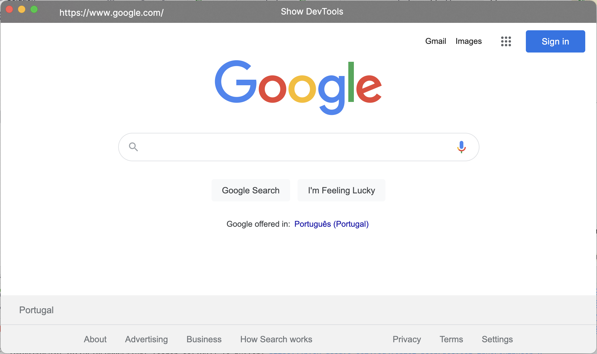

# WebView
[](https://www.nuget.org/packages/WebViewControl-Avalonia/)
[](https://www.nuget.org/packages/WebViewControl-WPF/)

Avalonia/WPF control that wraps CefGlue webview control



WebView lets you embed Chromium in .NET apps. It is a .NET wrapper control around [CefGlue](https://github.com/OutSystems/CefGlue) and provides a better and simple API. Likewise CefGlue it can be used from C# or any other CLR language and provides both Avalonia and WPF web browser control implementations. 

Here's a table for supported architectures, frameworks and operating systems:

| OS      | x64 | ARM64 | WPF | Avalonia |
|---------|-----|-------|-----|----------|
| Windows | ✔️  | ✔️      | ✔️   | ✔️        |
| macOS   | ✔️  | ✔️      | ❌  | ✔️        |
| Linux   | ✔️  | 🔘     | ❌  | ✔️        |

✔️ Supported | ❌ Not supported | 🔘 Works with issues.

See [LINUX.md](https://github.com/OutSystems/CefGlue/blob/main/LINUX.md) for more information about issues and tested distribution list. 
Currently only x64 and ARM64 architectures are supported.

It also provides the following additional features:
- Strongly-typed javascript evaluation: results of javascript evaluation returns the appropriate type
- Scripts are aggregated and executed in bulk for improved performance
- Ability to evaluate javascript synchronously
- Javascript error handling with call stack information
- Events to intercept and respond to resources loading
- Events to track file download progress
- Ability to load embedded resources using custom protocols
- Ability to disable history navigation
- Error handling
- Proxy configuration support
- Option to run in [offscreen rendering mode](https://bitbucket.org/chromiumembedded/cef/wiki/GeneralUsage#markdown-header-off-screen-rendering) (not recommended as it has several issues)

## Web engines
The controls render with one of two web engines, chosen at build time with the `WebViewEngine` property:

| `WebViewEngine` | Engine | Avalonia package | WPF |
|-----------------|--------|------------------|-----|
| `Cef` (default) | Chromium bundled with the app, through CefGlue | `WebViewControl-Avalonia`, `WebViewControl-Avalonia-ARM64` | ✔️ |
| `Native` | The web engine of the system: WKWebView on macOS, WebView2 on Windows | `WebViewControl-Avalonia-Native` (any architecture) | ❌ (always CEF) |

```
dotnet build WebViewControl.Avalonia/WebViewControl.Avalonia.csproj -p:WebViewEngine=Native
```

How the native engines work:
- macOS: WKWebView, driven through the Objective-C runtime (no binding library) and hosted by an Avalonia `NativeControlHost`.
- Windows: WebView2 (`Microsoft.Web.WebView2`), rendered in a child window hosted by an Avalonia `NativeControlHost`. It requires the WebView2 Runtime, which ships with Windows 10 and 11.
- The `embedded`, `custom` and `local` schemes are served through the same `BeforeResourceLoad` pipeline as with CEF.
- A javascript bridge (`window.webviewBridge`) replaces the CefGlue bindings: registered .NET objects are exposed as global objects whose methods return promises, and `webviewBridge.checkObjectBound(name)` replaces `cefglue.checkObjectBound(name)`.

Differences from CEF, and features not available yet with the native engines:
- Scripts are evaluated, and objects are bound, in the main frame only.
- The UI thread must not block waiting for a script result (eg: `EvaluateScript(...).Result`), since results are delivered on the UI thread.
- Not implemented yet: download events, drag events, javascript dialog interception, proxy authentication, `IsSecurityDisabled`, `DisableFileDialogs`, off-screen rendering, closing the developer tools on Windows.
- macOS: `BeforeResourceLoad` only sees the custom schemes (WebKit doesn't let http(s) be intercepted), `KeyPressed` is not raised and resources of the custom schemes can't be redirected.
- Windows: `KeyPressed` is only raised for accelerator keys (eg: with Ctrl or Alt, function keys).
- Load error codes are those of the engine (NSURLError on macOS, `CoreWebView2WebErrorStatus` on Windows).

## Releases
Stable binaries are released on NuGet, and contain everything you need to embed Chromium in your .NET/CLR application.

## Documentation
See the [Sample](SampleWebView.Avalonia) project for example web browsers built with WebView. It demos some of the available features.

## Other
- [Avalonia FuncUI Support](https://github.com/WhiteBlackGoose/MoreFuncUI#morefuncuiwebview). 

## Versioning
The versioning system works as follows:

`<major>.<cef_version>.<patch>`

Whenever you fix a bug, please increase the patch version. \
Whenever you bring a new feature, please increase the major version. \
Use the minor version for the current cef version.

## TODO
- Improve documentation
